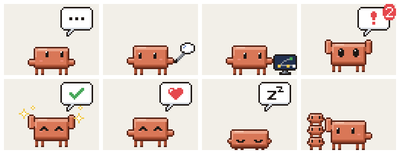

# Clawd Pet

A tiny pixel desktop pet for Windows that reacts to what [Claude Code](https://claude.com/claude-code) is doing: thinking, reading files, running commands, waiting for your permission, finishing a task. It uses no tokens and almost no system resources.



*All 86 animations are in [docs/art-sheet.png](docs/art-sheet.png).*

> **Unofficial fan project.** Not affiliated with or endorsed by Anthropic.

## What it does

- **Shows Claude's live state** across every Claude Code session on your machine, in the CLI and in the Claude desktop app's Code tab. Different tools get different animations: a magnifier for reading, a keyboard for edits, a terminal for shell commands (git, tests, builds and installs each look different), an antenna for web requests, and a mini Clawd for each subagent.
- **Gets your attention when Claude is waiting on you.** It jumps and shows a "!" for permission prompts and grows impatient if one goes unanswered. It shows a "?" when it's your turn. Clicking the tray icon (or "Go to…" in the menu) brings you to the session that needs you, including the exact chat in the desktop app.
- **Is a pet.** Pet it, drag it, throw it, shake it, tickle it with the scroll wheel, or double-click for a trick. It falls under gravity, lands on the taskbar or on window title bars and rides along when you move the window. It hangs off screen edges, follows your cursor with its eyes, and gets sleepy and naps when nothing is happening. It can take a stroll if you let it.
- **Stays out of the way.** It hides during fullscreen apps and games, can stay on top only when Claude needs you, has a Do not disturb mode, and hides and quits along with the Claude desktop app.

## Requirements

- Windows 10 or 11 (x64)
- Claude Code (CLI or the desktop app's Code tab) on the same machine

## Install

1. Download `clawd-pet.exe` from the [latest release](https://github.com/haji5/clawd-pet/releases/latest). It's a single ~750 KB file with no installer and no runtime.
2. Run it. Clawd appears above the taskbar in the bottom-right corner with an icon in the system tray.
   *Windows SmartScreen may warn about an unrecognised app because the exe isn't code-signed. Choose "More info" → "Run anyway", or build it yourself (see below).*
3. Right-click Clawd or its tray icon and choose **Install Claude hooks**.
4. Start (or resume) a Claude Code session. Clawd reacts from now on.

"Install Claude hooks" copies the exe to `%LOCALAPPDATA%\clawd-pet\`, so you can delete the download afterwards. It adds Clawd's entries to `~/.claude/settings.json` and keeps a backup of the file first. Your other settings and hooks are left as they are.

By default, **Launch with Claude** is on: whenever a Claude Code session starts, it starts Clawd if it isn't running. Turn on **Start with Windows** in the menu if you want Clawd around all the time.

### Uninstall

1. Right-click Clawd → **Uninstall Claude hooks**. This removes only Clawd's entries from `settings.json`.
2. Untick **Start with Windows** if you turned it on, then **Quit**.
3. Delete `%LOCALAPPDATA%\clawd-pet\` (the exe) and `%APPDATA%\clawd-pet\` (settings).

You can also do this from a terminal:

```bash
clawd-pet.exe --install-hooks
```

```bash
clawd-pet.exe --uninstall-hooks
```

## Privacy and cost

- **No tokens, no network.** Clawd never calls an API or runs a model, and it never changes what Claude does. Its only network traffic is a UDP packet on `127.0.0.1`.
- **The hook is silent.** Claude Code runs `clawd-pet.exe --hook` asynchronously on each event. It prints nothing (hook output could end up in Claude's context) and always exits 0, so it can never block or alter an action. If Clawd isn't running, the packet is simply dropped.
- **Minimal data.** The hook forwards only the event name, tool name, session id, the project folder's name, subagent ids and, for shell commands, a one-word class (`git`, `test`, `build` or `install`). It never forwards the command itself, your prompts, file contents, tool inputs or transcripts. For "Go to the session", it also sends the session's parent process id and the desktop app's chat name. All of it stays in the pet's memory.

## Using it

| Do this | Clawd does |
|---|---|
| Click | Gets petted (heart) |
| Click rapidly | Giggles, then gets dizzy |
| Press and hold | Squishes, then springs back |
| Drag | Dangles and swings |
| Drag and let go while moving | Gets thrown, bounces and tumbles |
| Shake while dragging | Gets dizzy |
| Drop it at a screen edge | Hangs off the edge (click to climb back) |
| Double-click | Does a trick |
| Scroll over it | Gets tickled |
| Right-click | Opens the menu |
| Left-click the tray icon | Goes to the session that needs you |

The menu (right-click Clawd or the tray icon) has:

- **Go to…** each session that's waiting on you
- **Show / Hide**, **Size** (1×–6×), **Placement** (always on top, or on top only when Claude needs you), **Back to taskbar spot**
- **Behaviours**: perch on windows, follow the active window, eyes follow cursor, walk around, hide during fullscreen apps, show attention during fullscreen, time-of-day moods, sound when Claude needs you, hide and quit with the Claude app
- **Do not disturb**: naps through everything except permission prompts and questions
- **Launch with Claude**, **Start with Windows**, **Install / Uninstall Claude hooks**, **Quit**

### Settings file

Settings live in `%APPDATA%\clawd-pet\config.json` and are saved when you change them from the menu. You can also edit the file by hand. Missing keys use their defaults, and a value of the wrong type falls back to its own default. A few settings are only in the file:

| Key | Default | Meaning |
|---|---|---|
| `sleepAfterMinutes` | `10` | Idle minutes before Clawd falls asleep |
| `impatientAfterSeconds` | `30` | How long an unanswered permission prompt waits before Clawd gets impatient (`0` = never) |
| `permissionAnsweredAfterSeconds` | `10` | When a prompt counts as answered if Claude sends no reminder (`0` = off) |
| `perchDenyProcesses` | `["steam.exe", "EpicGamesLauncher.exe"]` | Processes whose windows Clawd never sits on |
| `port` | `47823` | Local UDP port between the hook and the pet |

## Footprint

Measured on an i7-13700H (20 logical CPUs) with `scripts/perf.ps1`. CPU is a percentage of the whole machine, as Task Manager shows it.

| | Measured |
|---|---|
| Executable | ~750 KB, one file |
| Memory | 0.5–1.9 MB private (the working set is trimmed whenever Clawd rests) |
| CPU asleep or hidden | ~0 % (no timers run) |
| CPU awake and idle, eyes following the cursor | 0.011 % |
| CPU animating | 0.026 % |
| CPU while being dragged | 0.22 % |
| Hook run per event | ~6 ms |
| Startup to visible | ~11 ms |

It's written in Rust against raw Win32. The only dependencies are `windows-sys`, `serde` and `serde_json`. Frames are drawn only when something changes, and timers run only while something moves.

## Building from source

Needs [Rust](https://rustup.rs/) 1.85 or newer (edition 2024) with the MSVC toolchain.

```bash
cargo build --release
```

The exe is `target\release\clawd-pet.exe`. Hooks run the installed copy in `%LOCALAPPDATA%\clawd-pet\`, so after rebuilding, choose **Install Claude hooks** from the new exe to update it.

```bash
cargo test
```

```bash
cargo clippy --all-targets -- -D warnings
```

### Developer commands

| Command | What it does |
|---|---|
| `clawd-pet.exe --send PreToolUse --tool Read --project demo` | Sends a fake event to the running pet |
| `clawd-pet.exe --demo` | Cycles through every animation |
| `clawd-pet.exe --export-sheet sheet.bmp --scale 4` | Renders every animation into a labelled image |
| `clawd-pet.exe --art assets\sprites.txt` | Loads the sprites from disk and reloads them when the file changes |
| `clawd-pet.exe --hidden` | Starts with only the tray icon |
| `clawd-pet.exe --debug-log` | Writes a log to `%TEMP%\clawd-pet.log` |
| `clawd-pet.exe --dump-windows out.txt` | Shows which open windows Clawd could perch on |

### Project layout

- `src/` is platform-neutral, unit-tested logic: the hook (`hook.rs`), session tracking (`tracker.rs`), animation (`anim.rs`), physics, perching and settings. `src/win/` holds all the Windows code: the layered window, the tray, the WinEvent hooks and the processes.
- `assets/` has the art as text. `sprites.txt` documents its own format at the top, and colours live in `palette.txt`. `scripts/gen-bodies.py` generates the body poses.
- `tests/` has integration tests (the hook must stay silent, and the installer must round-trip `settings.json` byte for byte) and scrubbed hook payloads in `tests/fixtures/`.
- `docs/hook-findings.md` records how Claude Code's hooks actually behave on Windows.

## Limitations

- Windows only.
- Only Claude Code sessions on this machine. Claude.ai chats and cloud sessions don't run local hooks.
- Claude Code sends no event when you answer a permission prompt, so Clawd sometimes has to infer that a prompt was answered.

## License

[MIT](LICENSE)
